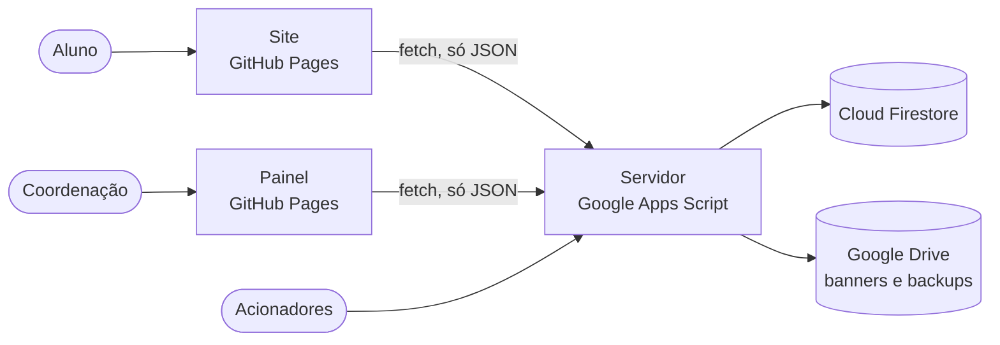

<div align="center">

# CESUTECH

**Inscrição e gestão de alunos dos projetos de extensão do Centro Universitário CESUSC**

[](https://github.com/cesutech/cesutech.github.io/actions/workflows/testes.yml)
[](https://github.com/cesutech/cesutech.github.io/actions/workflows/publicar-site.yml)

[Site do aluno](https://cesutech.github.io/) · [Painel da coordenação](https://cesutech.github.io/painel/) · [Segurança](SECURITY.md)

</div>

O aluno abre o site, escolhe um projeto, confere a matrícula e se inscreve, sem
criar conta. A coordenação acompanha as vagas, importa a lista oficial da
secretaria e concilia inscrição com matrícula num painel de gestão.

## Como funciona



| Camada | Tecnologia |
| --- | --- |
| Site do aluno e painel de gestão | HTML, CSS e JavaScript, sem framework |
| Hospedagem do site e do painel | GitHub Pages (conteúdo estático) |
| Servidor | Google Apps Script, como web app que só responde JSON |
| Banco de dados | Cloud Firestore, acessado por API REST |
| Arquivos | Google Drive: banners dos projetos e backups do banco |
| Entrada no painel | conta Google (Google Identity Services) ou link de acesso por e-mail |
| Testes | Node.js, sem dependências externas |

Três acionadores rodam sozinhos: a reconciliação das inscrições com a lista
oficial e o backup do banco, uma vez por dia, de manhã cedo, e o aquecimento do
web app, a cada cinco minutos.

Tudo cabe na camada gratuita do Google e do GitHub. Não há servidor para manter,
conta de serviço, chave guardada nem cartão de crédito: o acesso ao banco usa o
token da própria execução.

## Segurança

- **Superfície pública fechada.** O servidor só responde JSON e só aceita uma
  lista fechada de ações. Todo o resto é privado, e testes por árvore sintática
  conferem essa lista a cada mudança.
- **Entrada no painel** pela conta Google, com o token conferido no próprio
  Google, ou por link de uso único enviado por e-mail.
- **Dois níveis de acesso**, coordenador geral e professor, cobrados pelo
  servidor em toda requisição. O professor lê as listas e as fichas de todos os
  alunos e exporta o cadastro completo, mas não altera nada: os níveis separam
  ações, e não o acesso ao dado. A tela esconde as abas e desabilita os botões
  que não são de cada um, mas quem recusa é o servidor.
- **Rotas públicas com freios** contra abuso: teto por hora na inscrição, na
  conferência de matrícula e na entrada pela conta Google, freio por endereço no
  link por e-mail, e campo-isca e tempo mínimo de preenchimento no formulário.
  A configuração e os tetos ficam no cache do script, e sessão ou link
  inventado tem teto próprio, então um robô recusado não esgota a cota de
  leituras do banco nem a das propriedades do script.
- **Trilha de auditoria.** O Histórico do painel diz quem fez o quê.
- **Backup diário** do banco no Google Drive.
- **Nenhum dado pessoal no repositório.** As amostras dos testes são inventadas.

Para relatar uma vulnerabilidade, veja o [SECURITY.md](SECURITY.md).

## Guias

| Guia | Quando ler |
| --- | --- |
| [Configurar o ambiente do zero](guias/configurar-o-ambiente.md) | ao montar o sistema numa conta ou num repositório novos |
| [Decisões que explicam o resto](guias/decisoes.md) | antes de mexer no código |
| [Um projeto por aluno, e a troca](guias/um-projeto-por-aluno.md) | antes de ligar a regra `aluno_projeto_unico` |
| [A lista oficial ao longo do semestre](guias/lista-oficial.md) | ao importar e revisar listas, e na virada de semestre |
| [Dois níveis de acesso ao painel](guias/niveis-de-acesso.md) | ao dar ou mudar o acesso de alguém |
| [Publicar o servidor](guias/publicar-o-servidor.md) | ao publicar uma versão nova do servidor |

**Antes de ligar `aluno_projeto_unico`**, leia o
[checklist](guias/um-projeto-por-aluno.md#antes-de-virar-a-chave-para-sim): a
base de hoje tem duplicidades, e a regra só vale daqui para a frente.

## O repositório

```
apps-script/   o servidor: as rotas, a lógica e o acesso ao banco
docs/          o que o GitHub Pages publica: o site do aluno e o painel
guias/         a documentação detalhada
testes/        a suíte automatizada
```

O código é comentado em português. Os comentários explicam **por que** cada
decisão foi tomada, e não o que a linha faz. Onde um comentário manda ler o
README, o texto hoje mora num dos guias.

## Testes

```
npm test
```

São mais de dois mil testes, e nenhum precisa de rede, credencial ou conta
Google. Eles carregam o servidor num ambiente isolado, com um banco falso em
memória, e o painel num navegador falso. Um arquivo é dedicado a atacar o próprio
sistema, e outro confere por árvore sintática que a superfície pública continua
fechada.

O CI roda a suíte em todo pull request, e a `main` só aceita merge com ela verde.

## Licença

MIT. Use, estude, adapte.
